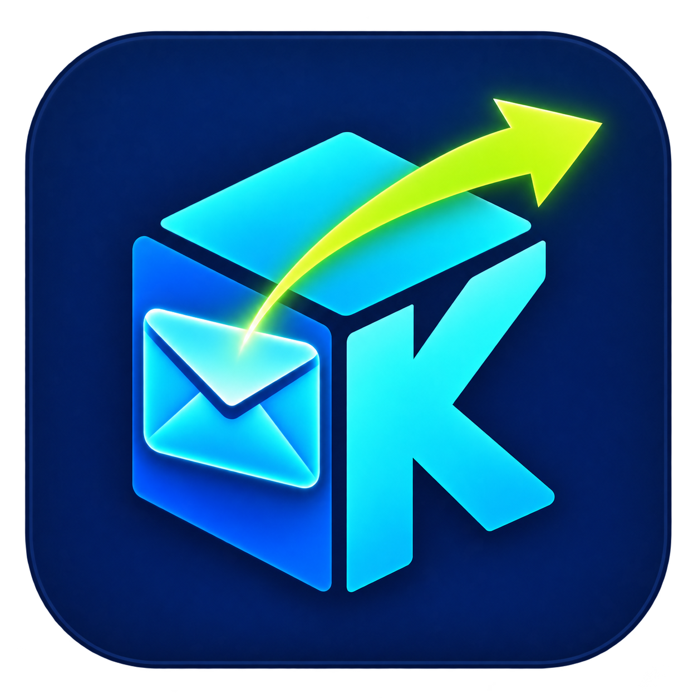
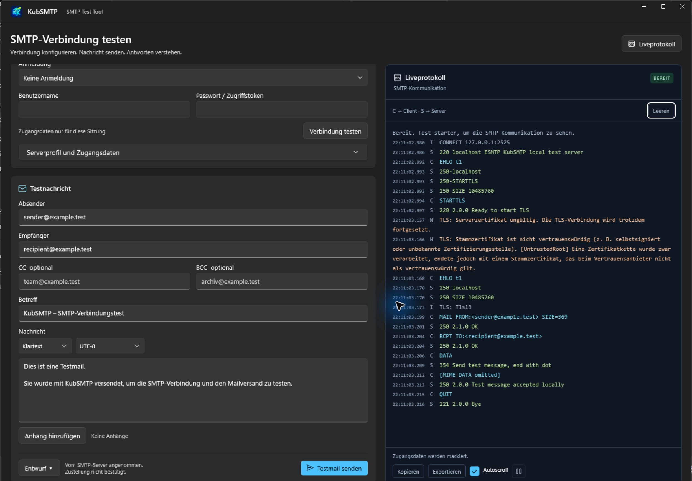

# KubSMTP

[Deutsch](README.md) · **English**

KubSMTP is a portable SMTP testing application for Windows. Test mail server connections, send test messages and inspect SMTP traffic and TLS certificate errors in a live log.

**[Download the portable EXE](https://github.com/nkxy1/KubSMTP/releases/latest)** · Version **1.0.9** · Windows x64, primarily Windows 11



*Actual application with fictitious `.test` addresses and a local SMTP test server. No message was delivered externally.*

## Getting started

1. Download `KubSMTP.App.exe` from the latest release and copy it to a folder of your choice.
2. Run the EXE. .NET, WinUI and the required application libraries are included. No runtime installation or administrator privileges are needed.
3. On first launch, a progress window shows extraction progress with a percentage and a Cancel button. Subsequent launches reuse the cache without extracting again. Extraction runs again after an update that changes the payload or after the cache is removed.

## Features

| Area | Options |
| --- | --- |
| Connection | Hostname, IPv4 or IPv6; connection test without sending mail |
| Ports | Dropdown with 25, 465, 587 and 2525; custom port from 1 to 65535 |
| Encryption | Implicit TLS, required or opportunistic STARTTLS, unencrypted connection |
| Authentication | None, username/password or OAuth2 using an existing access token; authentication requires TLS |
| Test messages | Sender, recipients, CC/BCC, subject and multiple attachments |
| Message format | Plain text or HTML with editable test message templates mentioning KubSMTP |
| Encoding | UTF-8, ISO-8859-1, Windows-1252 or US-ASCII for the body and subject |
| Result | Popup reporting success, failure or cancellation after a send attempt |
| Live log | Colored client/server traffic; automatic scrolling, pause, clear, copy and export |
| Reuse | Explicitly save and load the server profile and message drafts |
| Appearance | Follows Windows light/dark mode automatically; separate dark blue live log |
| Language | German for a German Windows display language, otherwise English |

## Sending a test message

1. Select the host, port and encryption mode required by your server. Common combinations are **587 with STARTTLS** and **465 with implicit TLS**. Port and encryption are configured independently.
2. Configure authentication if needed. OAuth2 requires an existing access token; signing in to a provider is not built in.
3. Use **Test connection** to check connectivity first.
4. Enter sender and recipient addresses, edit the subject and template, select the format and encoding, and add attachments if needed. Address lists accept commas and semicolons.
5. Click **Send test mail** and inspect the result and server responses in the live log.

SMTP server acceptance does not confirm inbox delivery. After a timeout or cancellation, delivery status may be unknown. KubSMTP does not retry automatically. Characters that cannot be represented in the selected encoding produce an error.

## TLS and certificate diagnostics

**KubSMTP intentionally connects over TLS even when the server certificate is invalid.** The live log explains detected problems such as expiration, a certificate that is not yet valid, a hostname mismatch, an untrusted issuer, an incomplete certificate chain or revocation errors. Multiple causes are reported together.

Traffic remains encrypted when TLS negotiation succeeds, but a valid server identity is not enforced when certificate errors occur. This diagnostic behavior applies to implicit TLS and both STARTTLS modes. Opportunistic STARTTLS can continue without encryption if the server does not offer STARTTLS; authentication remains blocked in that case.

## Local data

Profiles, drafts and logs are stored in `%LOCALAPPDATA%\KubSMTP`. The extracted application cache is stored there in `Runtime\<content hash>`.

Credentials stay in memory by default. When saving the profile, you can optionally store them encrypted with Windows DPAPI for the current user. Passwords, access tokens and MIME contents are redacted before reaching the UI or log file. Logs can still contain hostnames and email addresses. Retention is limited to 14 days or 50 MB.

Drafts contain message data and the original attachment paths. Attachment files are not copied into the draft.

## Building from source

Building requires Windows, the .NET 10 SDK, Python 3 and Zig 0.17.1 for the portable EXE. Pass custom tool paths to `Publish.ps1` using `-Dotnet`, `-Python` and `-Zig`.

```powershell
dotnet build KubSMTP.sln -c Release
dotnet run --project tests/KubSMTP.Tests -c Release
./build/Publish.ps1
./build/Test-Portable.ps1
```

The portable build is written to `artifacts/KubSMTP.App.exe`. Tests use local SMTP servers and fictitious addresses. The [development documentation (German)](docs/DEVELOPMENT.de.md) covers architecture, tests, startup optimization and validation limits.
