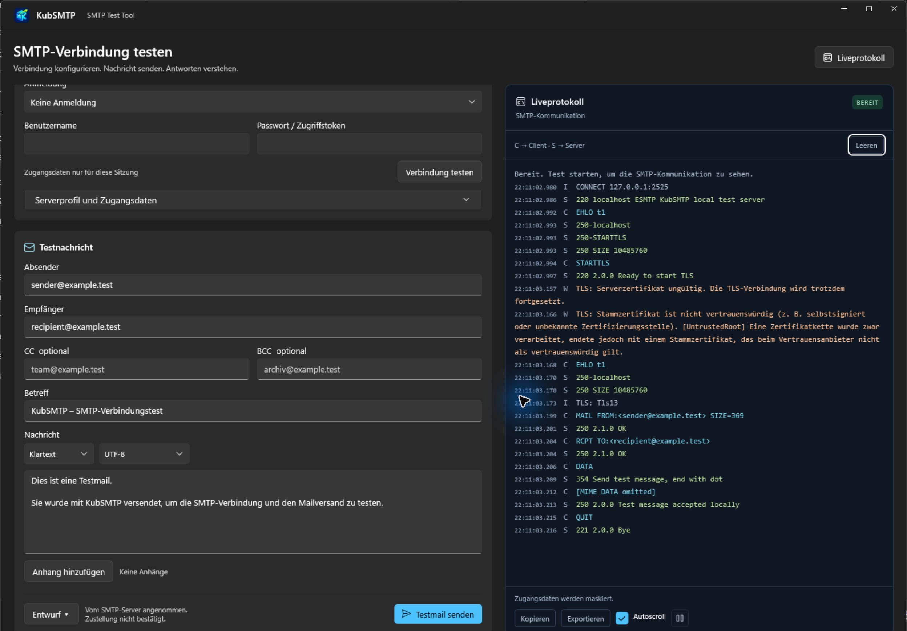

# KubSMTP

**Deutsch** · [English](README.en.md)

KubSMTP ist ein portables SMTP-Testprogramm für Windows. Es testet Mailserver-Verbindungen, versendet Testmails und zeigt SMTP-Kommunikation sowie TLS-Zertifikatsfehler im Liveprotokoll.

**[Portable EXE herunterladen](https://github.com/nkxy1/KubSMTP/releases/latest)** · Version **1.0.9** · Windows x64, primär Windows 11



*Aufnahme der Anwendung mit erfundenen `.test`-Adressen und einem lokalen SMTP-Testserver. Es wurde keine Mail extern zugestellt.*

## Starten

1. `KubSMTP.App.exe` aus dem aktuellen Release herunterladen und in einen beliebigen Ordner kopieren.
2. Die EXE starten. .NET, WinUI und alle benötigten Programmbibliotheken sind enthalten. Eine Runtime-Installation oder Administratorrechte sind nicht nötig.
3. Beim ersten Start zeigt ein Fortschrittsfenster das Entpacken mit Prozentanzeige und Abbrechen-Schaltfläche. Weitere Starts verwenden den Cache ohne erneutes Entpacken. Nach einem Update mit geändertem Inhalt oder dem Entfernen des Caches wird erneut entpackt.

## Funktionen

| Bereich | Möglichkeiten |
| --- | --- |
| Verbindung | Servername, IPv4 oder IPv6; Verbindungstest ohne Mailversand |
| Ports | Dropdown mit 25, 465, 587 und 2525; eigener Port von 1 bis 65535 |
| Verschlüsselung | Implizites TLS, verpflichtendes oder optionales STARTTLS, unverschlüsselte Verbindung |
| Anmeldung | Ohne Anmeldung, Benutzername/Passwort oder OAuth2 mit vorhandenem Zugriffstoken; Anmeldung erfordert TLS |
| Testmail | Absender, Empfänger, CC/BCC, Betreff und mehrere Anhänge |
| Nachricht | Klartext oder HTML mit bearbeitbarer Testmail-Vorlage und Hinweis auf KubSMTP |
| Codierung | UTF-8, ISO-8859-1, Windows-1252 oder US-ASCII für Text und Betreff |
| Ergebnis | Popup nach dem Versand mit Erfolg, Fehler oder Abbruch |
| Liveprotokoll | Farbige Client-/Server-Kommunikation; Autoscroll, Pause, Leeren, Kopieren und Export |
| Wiederverwendung | Serverprofil und Mailentwürfe ausdrücklich speichern und laden |
| Darstellung | Automatischer Wechsel mit dem Windows-Hell-/Dunkelmodus; separates dunkelblaues Liveprotokoll |
| Sprache | Deutsch bei deutscher Windows-Anzeigesprache, sonst Englisch |

## Eine Testmail senden

1. Host, Port und Verschlüsselung passend zum Server wählen. Häufige Kombinationen sind **587 mit STARTTLS** und **465 mit implizitem TLS**. Port und Verschlüsselung werden unabhängig gewählt.
2. Bei Bedarf die Anmeldung konfigurieren. Für OAuth2 muss bereits ein gültiges Zugriffstoken vorliegen; eine Provider-Anmeldung ist nicht eingebaut.
3. Mit **Verbindung testen** zunächst den Verbindungsaufbau prüfen.
4. Absender und Empfänger eintragen, Betreff und Vorlage bearbeiten, Format und Codierung wählen und bei Bedarf Anhänge hinzufügen. Adresslisten akzeptieren Komma und Semikolon.
5. **Testmail senden** anklicken und Ergebnis sowie Serverantworten im Liveprotokoll prüfen.

Die Annahme durch den SMTP-Server bestätigt keine Zustellung ins Postfach. Nach Timeout oder Abbruch kann der Versandstatus unbekannt sein. KubSMTP wiederholt den Versand nicht automatisch. Nicht darstellbare Zeichen in der gewählten Codierung werden als Fehler gemeldet.

## TLS und Zertifikatsdiagnose

**KubSMTP verbindet sich absichtlich auch bei ungültigen Serverzertifikaten per TLS.** Das Liveprotokoll nennt die erkannten Gründe, etwa Ablaufdatum, noch nicht begonnene Gültigkeit, falscher Hostname, nicht vertrauenswürdiger Aussteller, unvollständige Zertifikatskette oder Widerrufsfehler. Mehrere Ursachen werden gemeinsam ausgegeben.

Bei erfolgreichem TLS-Aufbau bleibt die Verbindung verschlüsselt; eine gültige Serveridentität wird bei Zertifikatsfehlern jedoch nicht erzwungen. Dieses Verhalten dient der Fehlersuche und gilt für implizites TLS sowie beide STARTTLS-Modi. Optionales STARTTLS kann ohne TLS fortfahren, wenn der Server STARTTLS nicht anbietet; eine Anmeldung bleibt dann gesperrt.

## Lokale Daten

Profile, Entwürfe und Protokolle liegen unter `%LOCALAPPDATA%\KubSMTP`. Der entpackte Programm-Cache liegt dort unter `Runtime\<Inhaltshash>`.

Zugangsdaten bleiben standardmäßig im Arbeitsspeicher. Optional lassen sie sich beim Speichern des Profils per Windows-DPAPI für den aktuellen Benutzer verschlüsselt ablegen. Passwörter, Zugriffstoken und MIME-Inhalte werden vor der Ausgabe in Oberfläche und Logdatei ausgeblendet. Protokolle können weiterhin Servernamen und Mailadressen enthalten; sie werden nach 14 Tagen bzw. bei Überschreiten von 50 MB bereinigt.

Entwürfe enthalten Maildaten und ursprüngliche Dateipfade der Anhänge. Die Anhangdateien selbst werden nicht in den Entwurf kopiert.

## Aus dem Quellcode bauen

Benötigt werden Windows, das .NET-10-SDK, Python 3 und Zig 0.17.1 für die portable EXE. Werkzeugpfade können an `Publish.ps1` über `-Dotnet`, `-Python` und `-Zig` übergeben werden.

```powershell
dotnet build KubSMTP.sln -c Release
dotnet run --project tests/KubSMTP.Tests -c Release
./build/Publish.ps1
./build/Test-Portable.ps1
```

Die portable Ausgabe entsteht unter `artifacts/KubSMTP.App.exe`. Der Testläufer verwendet lokale SMTP-Server und künstliche Adressen. Weitere Details zu Aufbau, Tests, Startoptimierung und Prüfgrenzen stehen in der [Entwicklungsdokumentation](docs/DEVELOPMENT.de.md).
